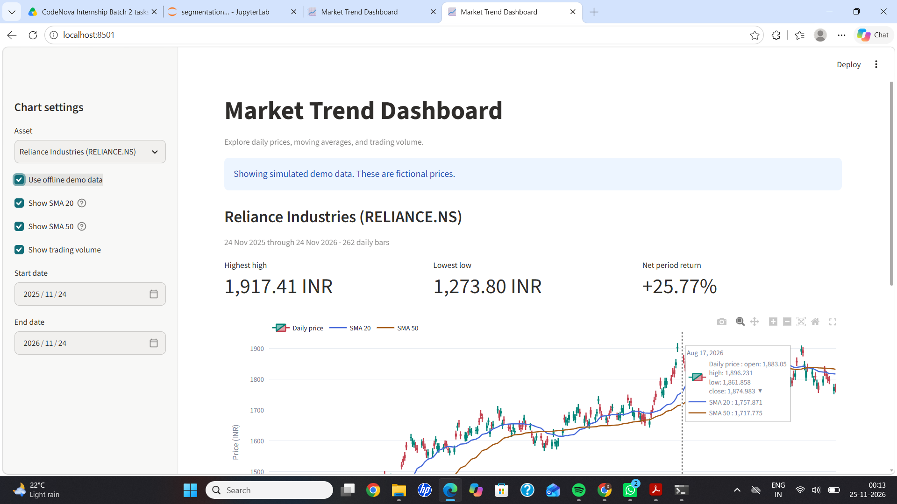
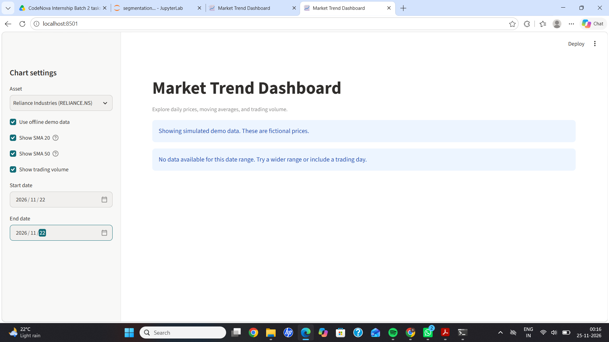

# Market Trend Dashboard

A Streamlit dashboard for exploring daily prices, moving averages, and volume
across eight assets. Built for CodeNova Data Science Task 3.

## Run locally

1. Install dependencies with `python -m pip install -r requirements.txt`.
2. Start the dashboard with `python -m streamlit run app.py`.
3. For offline testing, select **Use offline demo data** in the sidebar.

## Calculations

- Highest high and lowest low use the daily extremes inside the selected dates.
- Period return is `(last close / first close - 1) * 100`. It excludes dividends.
- SMA 20 and SMA 50 use earlier trading bars before the selected window.
- Volume colors show whether the daily close was at or above the open.

The app uses Streamlit, Plotly, pandas, and yfinance. Yahoo Finance data
availability can vary. The bundled fallback prices are simulated and labeled
in the dashboard. Run `python check_metrics.py` to check the formulas.

## Screenshots

**Dashboard with offline demo data**

**Empty date range**

